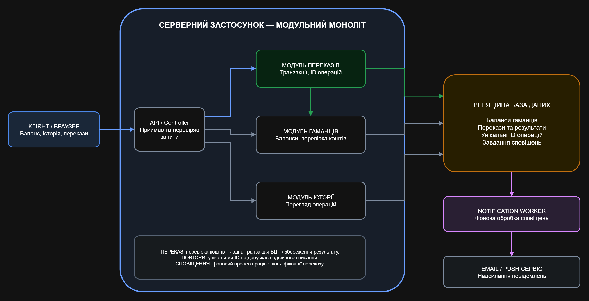

# Практична робота №1
## Моделювання грошового переказу

Виконав: Омельчук Максим
Група: ІПЗ-33
Заявлений рівень: 60 балів

### Мета роботи
Навчитися моделювати архітектуру системи грошових переказів і визначати відповідальність її компонентів.

### Обране архітектурне рішення
Варіант А — модульний моноліт.

Я обрав цей варіант через невелику команду та обмежений термін розробки. Модулі гаманців, переказів та історії працюватимуть в одному серверному застосунку зі спільною реляційною базою даних. Це дозволяє виконувати списання, зарахування та збереження результату в одній транзакції. Сповіщення оброблятимуться окремим фоновим процесом.

### 1. Структурна схема

Для системи електронного гаманця я обрав модульний моноліт. Усі основні модулі працюють в одному серверному застосунку та використовують спільну реляційну базу даних.

[Редагована схема draw.io](wallet-architecture.drawio)

Компоненти:
- API / Controller — приймає запити користувачів.
- Модуль гаманців — перевіряє та змінює баланси.
- Модуль переказів — виконує перекази та контролює транзакції.
- Модуль історії — надає інформацію про операції.
- База даних — зберігає баланси, перекази й результати.
- Notification Worker — обробляє завдання надсилання повідомлень.

### 2. Таблиця відповідальності

| Правило | Відповідальний компонент | Механізм реалізації |
|---|---|---|
| Баланс не може бути від'ємним | Модуль гаманців та БД | Перед списанням перевіряється доступний баланс. Записи блокуються на час транзакції. Якщо коштів недостатньо, списання не виконується. |
| Переказ повинен бути атомарним | Модуль переказів та БД | Списання, зарахування і запис результату виконуються в одній транзакції. При помилці всі зміни відкочуються. |
| Повторний запит не створює подвійного списання | Модуль переказів та БД | Кожен переказ має унікальний ID. База забезпечує його унікальність, а повторний запит отримує вже записаний результат. |
| Результат не губиться після перезапуску | Реляційна БД | Переказ і його результат зберігаються до підтвердження успішної операції. Після перезапуску система читає збережені дані. |

### 3. Обробка сповіщень

Після успішного переказу система зберігає завдання сповіщення в базі даних у межах тієї самої транзакції. Окремий фоновий процес читає ці завдання та передає повідомлення до Email / Push сервісу.

Якщо сервіс сповіщень тимчасово недоступний, грошовий переказ не скасовується, а завдання можна повторити.

### Висновок

У практичній роботі я спроєктував архітектуру системи електронних переказів на основі модульного моноліту. Визначив відповідальність компонентів та способи забезпечення правильності операцій. Обране рішення підходить для невеликої команди й дозволяє виконувати перекази в одній транзакції бази даних.
