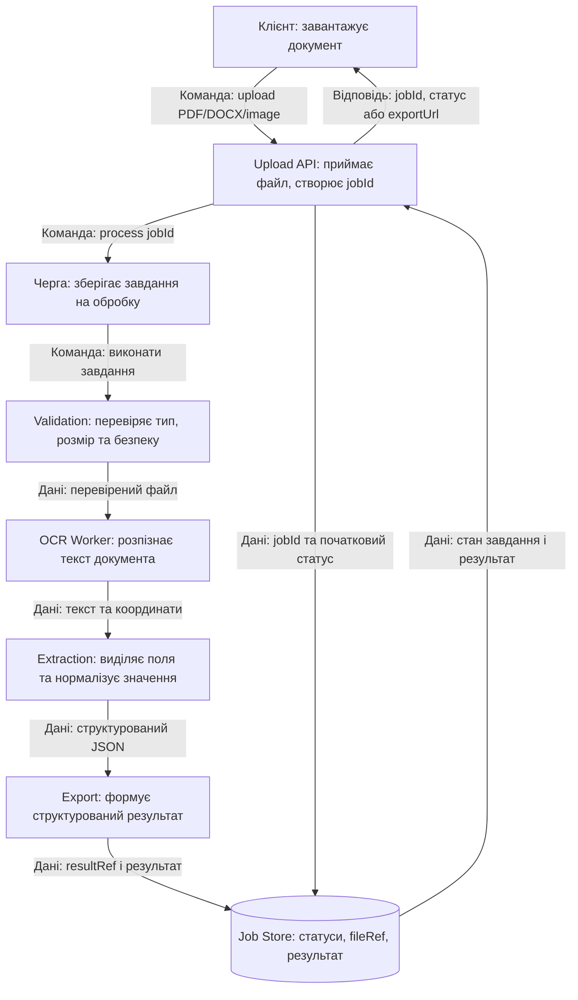

# Практична робота №5

## Архітектурні стилі: проєктування системи DocuFlow

**Виконав:** Омельчук Максим  
**Група:** ІПЗ-33  
**Заявлений рівень:** 60 балів

## Мета роботи

Навчитися порівнювати архітектурні стилі, обирати підхід до організації компонентів та моделювати послідовне перетворення документів.

## 1. Умова задачі

DocuFlow — SaaS-платформа для обробки документів.

Користувач завантажує PDF, DOCX або зображення. Система перевіряє файл, розпізнає текст, виділяє структуровані дані та дозволяє експортувати результат.

Вихідні умови:
- 50 корпоративних клієнтів;
- звичайне навантаження — 80 документів/хв;
- пікове — 600 документів/хв;
- OCR обробляє документ у середньому за 4 секунди;
- початково є 8 OCR workers;
- результати та статуси зберігаються після перезапуску;
- помилка одного документа не зупиняє інші;
- команда з 6 розробників має 4 місяці до релізу.

## 2. Порівняння архітектурних стилів

| Стиль | Механізм організації | Застосування у DocuFlow | Оцінка для основного процесу |
|---|---|---|---|
| Layered | Поділ системи на шари, наприклад API, бізнес-логіку та доступ до даних. | Організація вебзастосунку, перевірки запитів і роботи зі сховищем. | Корисний для розділення відповідальності, але не визначає послідовність OCR та перетворень. |
| Hexagonal | Бізнес-логіка взаємодіє із зовнішніми технологіями через порти й адаптери. | Підключення OCR-провайдерів, файлових сховищ та експорту. | Полегшує заміну інтеграцій, але сам по собі не описує порядок обробки документа. |
| Microkernel | Стабільне ядро й додаткові плагіни, які підключають нову функціональність. | Спеціальні правила обробки та формати для корпоративних клієнтів. | Підходить для розширень, але не є основним механізмом послідовного перетворення файлу. |
| Pipeline | Дані проходять послідовні етапи, кожен із яких виконує власне перетворення. | Перевірка → OCR → виділення полів → експорт. | Найкраще підходить для основного процесу DocuFlow, оскільки етапи мають визначені входи та виходи. |
| Space-Based | Навантаження розподіляється між обчислювальними вузлами з використанням розподіленого простору даних. | Може допомогти при значному масштабуванні обробки та швидкому доступі до стану. | Для початкової версії надто складний. Потрібне також надійне постійне зберігання результатів. |

### Обраний стиль — Pipeline

Основний процес DocuFlow складається з послідовних перетворень одного документа.

Кожен етап отримує визначений формат даних і повертає результат для наступного етапу.

Переваги:
- зрозуміла послідовність обробки;
- окрема відповідальність кожного етапу;
- можливість незалежно перевіряти етапи;
- помилку конкретного документа можна ізолювати;
- важкий OCR-етап можна виконувати через окремих workers.

Недоліки:
- повільний етап збільшує загальний час обробки;
- потрібно узгоджувати формати даних між етапами;
- для відновлення після збою необхідно зберігати стан завдань.

Додатково можна використовувати Layered для API та Hexagonal для зовнішніх інтеграцій. Але головний процес залишається Pipeline.

## 3. Архітектурна схема



### Відповідальність компонентів

**Upload API** приймає документ, зберігає оригінал у файловому сховищі та реєструє окреме завдання з унікальним jobId.

**Черга** відокремлює прийом документа від тривалої обробки.

**Validation** перевіряє підтримуваний формат, розмір та базові обмеження безпеки.

**OCR Worker** розпізнає текст із документа. Для DOCX із доступним текстовим шаром може використовуватися пряме витягування тексту без OCR.

**Extraction** знаходить потрібні бізнес-поля й перетворює їх у структуровані значення.

**Export** формує підсумковий JSON або CSV.

**Job Store** зберігає стани та посилання на результати. Після кожного етапу координатор обробки оновлює стан завдання.

### Пояснення стрілок

| Звідки → куди | Тип | Що передається |
|---|---|---|
| Клієнт → Upload API | Команда | Файл PDF/DOCX/image та дані клієнта |
| Upload API → Черга | Команда | Запит обробити документ за jobId |
| Черга → Validation | Команда | Завдання, jobId та посилання на файл |
| Validation → OCR | Дані | Перевірений документ або fileRef |
| OCR → Extraction | Дані | Розпізнаний текст, блоки й координати |
| Extraction → Export | Дані | Структурований JSON |
| Export → Job Store | Дані | Результат і посилання на експорт |
| Upload API → Job Store | Дані | Нове завдання та початковий статус |
| Job Store → Upload API | Дані | Поточний статус і результат за запитом |
| Upload API → Клієнт | Відповідь | jobId, статус або exportUrl |

Відповідь про прийняття документа не означає завершення обробки. Клієнт може перевіряти статус за jobId та отримати результат, коли завдання завершиться.

Стан кожного документа зберігається окремо. Якщо обробка одного файлу завершується помилкою, інші завдання можуть продовжувати виконання.

## 4. Модель виконання одного документа

### Вхідний документ

Приклад: PDF-рахунок із такими даними:

- Ім'я клієнта: Іван Петренко
- Номер рахунку: INV-2026-017
- Сума платежу: 1250,00 грн
- Дата операції: 17.11.2026

Це вигаданий навчальний приклад для демонстрації процесу.

### Покрокове перетворення

| Етап | Вхід | Перетворення | Вихід |
|---|---|---|---|
| 1. Upload | PDF-файл із рахунком | Приймання, збереження, створення jobId | fileRef та jobId |
| 2. Validation | fileRef і метадані PDF | Перевірка формату, розміру та обмежень | Підтверджений файл |
| 3. OCR | Перевірений PDF | Розпізнавання тексту рахунку | Текст: ім'я, номер, сума, дата |
| 4. Extraction | Розпізнаний текст | Пошук потрібних полів і нормалізація | Структурований JSON |
| 5. Export | JSON із полями | Формування файлу експорту | JSON-файл або CSV |
| 6. Result | Файл експорту | Збереження посилання та статусу | completed, exportUrl |

### Приклад результату Extraction

```json
{
  "clientName": "Іван Петренко",
  "invoiceNumber": "INV-2026-017",
  "amount": 1250.00,
  "currency": "UAH",
  "operationDate": "2026-11-17"
}
```

### Приклад CSV-експорту

```csv
clientName,invoiceNumber,amount,currency,operationDate
Іван Петренко,INV-2026-017,1250.00,UAH,2026-11-17
```

### Завершення обробки

Після успішного експорту завдання отримує статус `completed`, а клієнт може завантажити результат.

Якщо файл неправильного формату, Validation повертає помилку й завдання переходить у статус `failed`.

Якщо OCR Worker аварійно завершується, система зберігає вже зафіксований стан. Незавершене завдання можна повернути на обробку з урахуванням повторів.

Для ізоляції помилок кожен документ має власний jobId та окремий стан виконання.

## 5. Висновок

У практичній роботі я порівняв п'ять архітектурних стилів і визначив, що для основного процесу DocuFlow найкраще підходить Pipeline.

Побудував структурну схему, описав відповідальність компонентів, типи взаємодій та послідовність перетворення документа.

На прикладі PDF-рахунку показав повний процес від завантаження файлу до формування JSON і CSV.

Такий підхід дозволяє розділити етапи обробки й зберігати стан кожного документа окремо, хоча для надійного відновлення після збоїв потрібні додаткові механізми керування завданнями.
